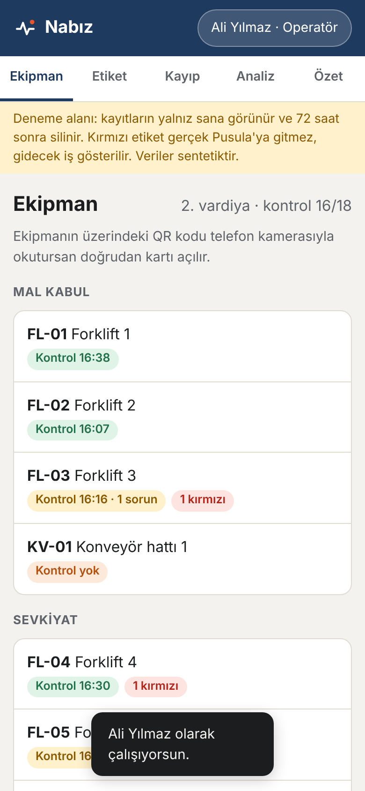
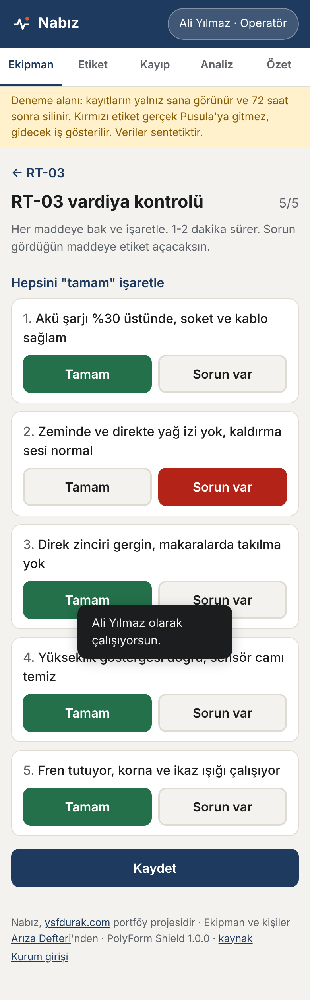
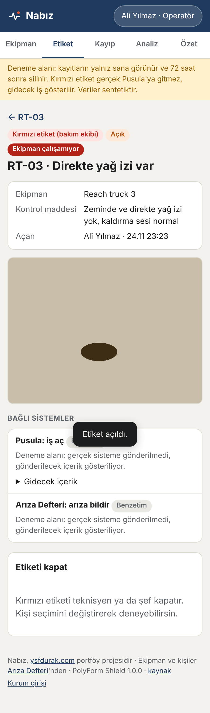
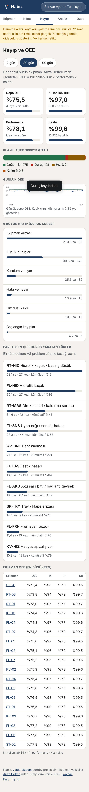
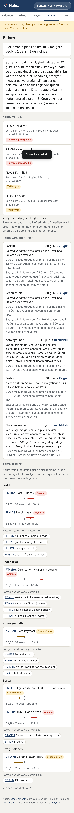
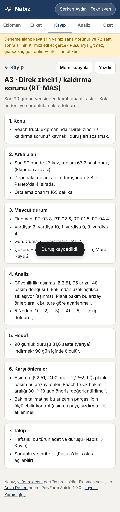

# Nabız

Depo ekipmanı için **TPM (Toplam Verimli Bakım)** uygulaması. Telefonla kullanılır. Operatör ekipmanın üzerindeki QR kodu okutur ve vardiya başı otonom bakım kontrolünü 1-2 dakikada yapar. Gördüğü sorunu etiketler:

- **Beyaz etiket:** Sorunu operatör kendisi giderir (temizlik, sıkma, akü değişimi) ve etiketi kendisi kapatır.
- **Kırmızı etiket:** Bakım ekibi gerekir. Etiket [Pusula](https://github.com/ysfdurak/pusula-is-takip)'da iş olarak açılır. "Ekipman çalışamıyor" işaretliyse [Arıza Defteri](https://github.com/ysfdurak/ariza-defteri)'ne arıza olarak da düşer. Teknisyen etiketi kapatınca iş de arıza kaydı da kapanır.

Ticari olmayan bir portföy projesidir. Arayüz Türkçedir. Demo veri sentetiktir: kurgusal Yıldız Ev & Yaşam deposu.

| Ekipman | Kontrol | Etiket | Kayıp ve OEE | Analiz | A3 |
|---|---|---|---|---|---|
|  |  |  |  |  |  |

## Ne yapar

- **QR → ekipman kartı.** Her ekipmanın QR kodu (`#/e/RT-03`) yazdırılabilir sayfada hazır durur. Telefon kamerası yeterlidir, uygulama içinde tarayıcı gerekmez.
- **Kontrol listesi:** Tipine göre 4-6 madde, her biri "tamam" ya da "sorun var". Sorunlu madde etiket açmaya götürür; rengi ve arıza türü önerilir.
- **Fotoğraf:** Telefonda 1280 piksele küçültülür ve JPEG'e çevrilir. Sunucu yalnız JPEG kabul eder, en çok 1,5 MB, başlık baytlarını da denetler.
- **Gönderim kuyruğu:** Pusula ya da Arıza Defteri o an cevap vermezse gönderim kaybolmaz. 1, 5, 15 ve 60 dakika arayla yeniden denenir. Durumu etiket sayfasında görünür.
- **Özet:** Kontrol uyumu (bugün, 7 gün, 30 gün), eksik kontroller, açık etiketler, ortalama kapanma süresi ve en sık sorunlu maddeler.
- **Demo:** Her ziyaretçi kendi deneme alanında çalışır. Alan örnek 7 günlük geçmişle açılır ve 72 saat sonra silinir. Gönderimler gerçek sisteme gitmez, "gidecek içerik" olarak gösterilir.
- **Duruş kaydı (V2):** Arıza dışındaki kayıplar da (ayar, küçük duruş, hız, kalite) telefondan girilir ve Arıza Defteri'ne gider.
- **Kayıp ve OEE (V2):** Depo, tip, ekipman ve gün bazında OEE (kullanılabilirlik × performans × kalite), kayıp şelalesi, 6 büyük kayıp, Pareto.
- **Analiz (V2):** [Nabız Analiz](https://github.com/ysfdurak/nabiz-analiz) (Python) her arıza türünün aşınma, rastgele ya da erken dönem davranışını ve tip başına önerilen bakım aralığını verir.
- **A3 taslağı (V2):** Pareto'daki bir türden tek dokunuşla problem çözme sayfası açılır. Karşı önlemler kural tabanlıdır, kök nedeni ekip yazar.
- **MCP:** Claude kurum alanını salt okuma araçlarıyla sorgular ("bu vardiya hangi ekipmanın kontrolü eksik?", "en çok duruş yaratan arıza neden sık?").

## Yapı

```
src/cekirdek/  kontrol listeleri · kurallar (vardiya, yetki, uyum) · örnek geçmiş
server/        servis (kurallar) ─┬─ web kapısı /v1 ─▶ telefon arayüzü (web/)
                                  └─ MCP kapısı /mcp ─▶ Claude (salt okuma)
               store (SQLite, alanlar) · entegrasyon (Arıza Defteri API, Pusula MCP, giden kutusu) · ana-veri (önbellekli)
```

Ekipman, kişi ve arıza türü listeleri Arıza Defteri'nden gelir. OEE ve kayıp verisi de oradan, güvenilirlik Nabız Analiz'den. Ona ulaşılamazsa son okunan liste, o da yoksa depodaki kopya (`veri/ana-veriler.json`) kullanılır.

## Kendi bilgisayarında dene

Node.js 22.13 ya da üstü gerekir.

```bash
npm install
npm run start:dev      # http://localhost:8081 (bağlantısız: gönderimler benzetim)
npm test               # kurallar, giden kutusu, Pusula istemcisi, API, MCP
```

Arıza Defteri ve Pusula ile birlikte denemek için: [docs/SUNUCU_KURULUMU.md](docs/SUNUCU_KURULUMU.md) → "Yerelde üçü birlikte".

## Belgeler

- [Proje dokümanı](docs/PROJE.md): kararlar, mimari, kod turu, testler, mülakat soruları
- [Sunucu kurulumu](docs/SUNUCU_KURULUMU.md): nabiz.ysfdurak.com, Pusula hizmet hesabı, kurum modu

## Lisans

Bu proje [PolyForm Shield 1.0.0](LICENSE.md) lisansıyla yayınlanır. Kaynak kodu açıktır, ancak resmi anlamda bir "açık kaynak" lisansı değildir. Kontrol listeleri ve örnek veri de aynı lisansa tabidir.

- **Serbest:** Kişiler, okullar ve şirketler kendi işlerinde ücretsiz kullanabilir, değiştirebilir ve kendi bilgisayarlarına ya da sunucularına kurabilir. İzin almak gerekmez.
- **Yazılı izin gerekir:** Yazılımı satmak, adını değiştirip ürün gibi sunmak ya da bununla (ücretsiz olsa bile) rakip bir ürün veya hizmet sunmak.
- **Garanti yok:** Yazılım olduğu gibi sunulur. Bağlayıcı olan İngilizce lisans metnidir.
- Üçüncü taraf bileşenler kendi lisanslarına tabidir.

Kurumunuzda kullanıyorsanız haber verirseniz sevinirim: kurulumda yardımcı olabilir, kurumunuza özel ihtiyaçları birlikte değerlendirebiliriz. Kurum içi kurulumda `.env` içinde `MOD=kurum` ve en az 12 karakterlik `SITE_SIFRESI` gerekir. Ayrıntı: [docs/SUNUCU_KURULUMU.md](docs/SUNUCU_KURULUMU.md). İletişim: iletisim@ysfdurak.com

### License (English)

Released under [PolyForm Shield 1.0.0](LICENSE.md). The source is available, but this is not an OSI "open source" licence. Checklists and sample data are covered by the same licence.

- **Free:** individuals, schools and companies may use it in their own work, change it and run it on their own computers or servers. No permission needed.
- **Needs written permission:** selling it, rebranding it as a product, or providing a product or service that competes with it (even free of charge).
- **No warranty:** provided as is. The English licence text is binding.
- Third-party components keep their own licences.

Using it in your organisation? I'd be glad to hear from you: I can help with setup and look at your organisation's needs together. Contact: contact@ysfdurak.com
