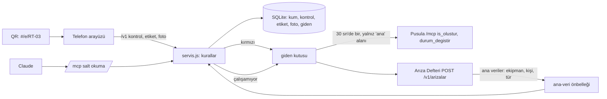
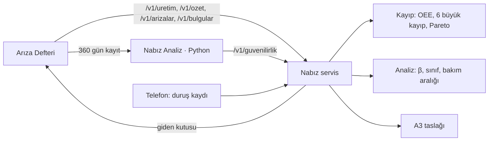

# Nabız: proje dokümanı

Kodu ben yazmamış olsam da projeyi baştan sona anlatabilmem ve savunabilmem için tutulur. Ortak altyapı (GitHub, Cloudflare, VPS, Docker, Caddy, güvenlik temeli, lisans) burada tekrar anlatılmaz: [ysfdurak.com → docs/](https://github.com/ysfdurak/ysfdurak.com/tree/main/docs). Kardeş servis: [Arıza Defteri → docs/PROJE.md](https://github.com/ysfdurak/ariza-defteri/blob/main/docs/PROJE.md).

Son güncelleme: 24 Kasım 2026 (V2).

---

## 1. Bir bakışta

| | |
| --- | --- |
| **Ne** | Depo ekipmanı için TPM uygulaması (telefon): QR ile vardiya başı otonom bakım kontrolü, kırmızı/beyaz etiket, Pusula'ya iş, Arıza Defteri'ne arıza |
| **Kimin için** | Operatör (kontrol, etiket), teknisyen (kırmızı etiketi kapatır), vardiya şefi ve yönetici (özet) |
| **Canlı adres** | https://nabiz.ysfdurak.com **[doğrulanacak: henüz kurulmadı]** |
| **Depo** | github.com/ysfdurak/nabiz **[doğrulanacak: henüz gönderilmedi]** |
| **Durum** | V2 bitti: duruş kaydı, OEE ve 6 büyük kayıp, Pareto → A3 taslağı, güvenilirlik ve bakım aralığı (Python servisi [Nabız Analiz](https://github.com/ysfdurak/nabiz-analiz)). Sırada V3: planlı bakım takvimi, TPM adım panosu. |

## 2. Sorun ve verdiğim kararlar

**Sorun.** TPM'in ilk adımı otonom bakımdır: operatör kendi ekipmanının temel durumunu her vardiya başında kontrol eder ve gördüğü anormalliği etiketler. Kâğıt formlar kaybolur. Etiketin bakım ekibine ulaşıp ulaşmadığı belli olmaz. Kimin hangi vardiyada kontrol yapmadığı ancak ay sonunda anlaşılır. Depo personeli de işten uzun süre ayrılamaz.

| Karar | Neden | Bedeli |
| --- | --- | --- |
| Kontrol 1-2 dakika, 4-6 madde, iki büyük düğme | Personel işten çekilemiyor; uzun form doldurulmaz | Ayrıntılı ölçüm (basınç, seviye) yok |
| QR telefon kamerasıyla okunur, uygulama içi tarayıcı yok | Her telefonda çalışır, kamera izni ve kitaplık gerekmez | QR adresi değişirse etiketler yeniden basılır |
| Beyaz etiket operatörde kalır, kırmızı Pusula'ya gider | TPM'in amacı operatörün küçük sorunları kendisinin gidermesi; bakım ekibine yalnız gerekeni göndermek | Yanlış renk seçilebilir; madde önerisiyle azaltıldı |
| "Ekipman çalışamıyor" → Arıza Defteri'ne gerçek arıza | Duruş tek kaynakta kalsın; Usta ve Emanet de görsün | İki sistemde kayıt var; etiket kimliği arıza açıklamasında |
| Gönderimler kuyrukta (giden kutusu) | Pusula ya da Arıza Defteri düşerse etiket kaybolmasın, kullanıcı beklemesin | Gönderim en geç 30 saniye sonra gider; "anında" değil |
| Demo: ziyaretçi başına deneme alanı, gönderim benzetimi | Herkes deneyebilsin ama gerçek Pusula'yı kirletemesin | Ziyaretçi gerçek entegrasyonu göremez, "gidecek içerik"i görür |
| Kurum modu: tek site şifresi + kişi seçimi | V1'i yalın tutmak | Kişiye özel giriş yok: herkes herkes adına kayıt açabilir. **Bilinen sınır.** |

## 3. Mimari ve veri akışı



**Alan (kum) kavramı.** Her satır bir alana aittir. `ana` kurumun gerçek alanıdır. Demo ziyaretçisi açtığında kendine rastgele bir alan açılır (çerezle bağlanır, 72 saatte silinir). Gönderimler yalnız `ana` alanından gerçekten gider. Ziyaretçi alanında aynı içerik "benzetim" olarak saklanır ve ekranda gösterilir.

**Bir kırmızı etiketin hayatı:**

```
Operatör kontrol → "Zeminde yağ izi" sorun var → kırmızı etiket + foto + çalışamıyor
  ├─ giden: pusula_ac    → Pusula'da iş: "[Kırmızı etiket] RT-03 (Reach truck 3): Direkte yağ", öncelik acil
  └─ giden: ariza_bildir → Arıza Defteri: G-20261124-…, RT-HID, açık
Teknisyen (Serkan) "Conta değişti" ile kapatır
  ├─ giden: pusula_kapat → Pusula'ya yorum + iş tamamlandı (tamamlanamazsa yorumla yetinilir)
  └─ giden: ariza_kapat  → Arıza Defteri kaydı kapanır, süre hesaplanır, çözen Serkan
```

Yerelde üç servis birlikte çalıştırılıp bu akış uçtan uca denendi: Pusula'da iş açıldı ve kapandı, Arıza Defteri'nde kayıt açıldı ve kapandı.

### V2: kayıp, OEE, güvenilirlik, A3



- **OEE** Nabız'ın çekirdeğinde hesaplanır (`src/cekirdek/oee.js`). Arıza Defteri ham vardiya verisini verir, TPM yorumu Nabız'dadır. Toplarken oranların ortalaması alınmaz: süreler ve adetler toplanır, oran sonra hesaplanır. Sentetik depoda OEE yaklaşık %75'tir: kullanılabilirlik %97, performans %78, kalite %99,6. Kaybın asıl kaynağı hız (bekleme, yol, arama).
- **Duruş kaydı:** Arıza dışındaki kayıplar (ayar, küçük duruş, hız, kalite) da telefondan girilir. Süre verilirse kapalı kaydedilir, "devam ediyor" seçilirse sonra karttan bitirilir. Arıza Defteri'ne giden kutusuyla gider ve Usta, Emanet, Analiz aynı veriyi görür. Uçtan uca denendi: Arıza Defteri'nde gerçek ve kapalı kayıt oluştu.
- **A3 taslağı** (`src/cekirdek/a3.js`): Pareto'daki bir türe dokununca açılır. 7 bölüm: konu, arka plan, mevcut durum, analiz, hedef, karşı önlemler, takip. Karşı önlemler kural tabanlıdır: aşınma ise bakım aralığı önerisi, rastgele ise kontrol listesi ve 5 Neden, erken dönem ise bakım sonrası kontrol; tekrarlayan gün ve tek kişi bulguları da eklenir. Kök neden ve sorumlular boş bırakılır, onları ekip doldurur.
- **Güvenilirlik** Nabız Analiz'den gelir (10 dakika önbellek). Servis yoksa "Analiz" ekranı 503 verir, A3 yine açılır ve o bölümde "alınamadı" yazar.

## 4. Teknoloji seçimleri

| Seçim | Neden | Elenen |
| --- | --- | --- |
| Node 22, `node:http`, `node:sqlite`, düz HTML/JS | Arıza Defteri ve Pusula ile aynı kalıp; derleme yok | React/Vite (Pusula'da var; burada gerek yok) |
| Pusula'ya MCP ile bağlanmak | Pusula'nın yazma kuralları (yetki, bildirim, denetim kaydı) MCP komutlarında hazır; ayrı API yazmadan aynı kurallar | Pusula'ya ayrı REST ucu eklemek; doğrudan veritabanına yazmak (kuralları atlar) |
| Giden kutusu tablosu | Kalıcı, yeniden denenebilir, etiket sayfasında görünür | Bellekte kuyruk (sunucu yeniden başlarsa kaybolur), anında çağrı (kullanıcı bekler) |
| `qrcode` paketi (sunucuda SVG) | Küçük, bağımlılığı az; tarayıcıya kitaplık gitmez | Dış QR servisi (ziyaretçi verisi dışarı çıkar) |
| Fotoğraf telefonda küçültülür, sunucu yalnız JPEG kabul eder | Yükleme hızlı; sunucuda resim işleme kitaplığı yok; SVG/HTML yüklenemez | Sunucuda yeniden kodlama (sharp: yerel kitaplık, büyük imaj) |
| Kişi seçimi tarayıcıda saklanır, sunucu rolü denetler | V1 sadeliği | Kişiye özel giriş (V3) |

## 5. Kod turu

| Dosya | Ne yapar | Dikkat |
| --- | --- | --- |
| `src/cekirdek/kontrol-listeleri.js` | Tip başına maddeler; her maddenin önerilen rengi ve Arıza Defteri türü | Test, her türün Arıza Defteri'nde olduğunu denetler |
| `src/cekirdek/kurallar.js` | `vardiyaBul`, `yetkiliMi`, `kontrolUyumu` | Uyumda henüz başlamamış vardiya beklenmez; aynı vardiyada iki kontrol bir sayılır |
| `src/cekirdek/ornek.js` | Demo için 7 günlük tohumlu geçmiş (gece vardiyası daha az uyumlu, RT-03 cuma hidrolik) | Arıza Defteri hikâyesiyle uyumlu |
| `server/store.js` | Alanlar, kontroller, etiketler, fotoğraf, giden kutusu, sayaçlar, oturumlar | Alan silinince içindekiler `ON DELETE CASCADE` ile gider |
| `server/servis.js` | Bütün kurallar: doğrulama, yetki, sınır, kuyruğa yazma, özet | `kuyruk()`: alan `ana` değilse ya da bağlantı yoksa benzetim |
| `server/entegrasyon.js` | Arıza Defteri istemcisi, Pusula MCP istemcisi, giden kutusu işleyicisi | Kalıcı hata (4xx) yeniden denenmez; geçici hata 6 kez denenir |
| `server/ana-veri.js` | Ekipman/kişi listesi: Arıza Defteri → son okunan → gömülü kopya | Arıza Defteri kapalıyken de açılır |
| `server/app.js` | Alan çözümleme (oturum → `ana`, çerez → deneme alanı), giriş, yollar, başlıklar, fotoğraf, QR | Kural içermez |
| `server/mcp.js` | 5 salt okuma aracı (`ana` alanı) | Yazma yok: kayıt sahadaki kişinin işi |
| `src/cekirdek/oee.js` | OEE bileşenleri, kayıp şelalesi (dakika), ekipman, tip ve gün kırılımı | Oran ortalaması değil, toplam üzerinden |
| `src/cekirdek/a3.js` | A3 taslağı: veriden 7 bölüm, kural tabanlı karşı önlemler | Kök neden ve sorumlu ekipte |
| `web/app.js` | Hash yönlendirme; ekipman, kart, kontrol, etiket, duruş, kayıp (OEE çizgisi SVG), analiz (β çubuğu SVG), A3, etiketler, özet, QR, giriş | Her metin `textContent`; SVG de DOM API ile |

## 6. Sunucu ve yayın

Ayrıntı: [docs/SUNUCU_KURULUMU.md](SUNUCU_KURULUMU.md).

- Önce Pusula'da `nabiz@ysfdurak.com` düzenleyici üye ve Pusula `.env`'de `MCP_TOKENS=nabiz@ysfdurak.com:<anahtar>`.
- `bash ~/ysfdurak.com/sunucu/kurulum-nabiz.sh`: Arıza Defteri yazma anahtarını oradaki `.env`'den alır, Pusula anahtarını sorar, site şifresi ve MCP anahtarını üretir.
- İç ağ: `http://ariza-defteri:8080`, `http://pusula:8080/mcp`. Anahtarlar internete çıkmaz.
- Konteyner salt okunur, `cap_drop: ALL`, 320 MB.

## 7. Testler

`npm test`: 22 test. Tarayıcı duman testi telefon boyutunda, açık ve koyu temada çalışır.

| Dosya | Neyi kanıtlıyor |
| --- | --- |
| `kurallar.test.js` | Vardiya sınırları; kırmızıyı yalnız teknisyen ve şef kapatır; uyum hesabı; her madde Arıza Defteri türüne bağlı |
| `entegrasyon.test.js` | Gönderim sırası ve kimliklerin etikete yazılması; geçici hata yeniden denenir, kalıcı hata hemen "hata"; ziyaretçi alanı hiç gönderilmez; Pusula istemcisi gerçek bir MCP sunucusuna karşı (anahtar, çalışma alanı, tamamlanamayan iş) |
| `api.test.js` | Deneme alanı açılır ve yalıtılır; çerez bayrakları; kontrol doğrulaması; kırmızı etiket akışı ve yetki; fotoğraf (JPEG baytları, 415, 413, başka site 403, sıkı CSP); IP ve alan sınırları; giriş sınırı (5 deneme); kurum modu; QR; MCP |
| `v2.test.js` | OEE elle hesaplananla aynı ve toplamda süre ağırlıklı; gerçek veride A × P × K = OEE; A3'te aşınma ve cuma bulgusu karşı önlem olarak geliyor; kayıp, güvenilirlik ve A3 uçları; analiz servisi yokken 503 ama A3 açık; duruş kaydı (süreli ve devam eden) ve hatalı girdiler; duruşun arıza kimliği giden kutusunda duruşa yazılıyor |
| `gercek-ip.test.js` | Sahte başlıkla hız sınırı atlatılamaz |
| `tarayici/duman_test.py` | Kişi seç → kart → kontrol (1 sorun) → kırmızı etiket + foto (1280 piksele küçüldü mü) → operatör kapatamaz → teknisyen kapatır → etiketler → özet → QR; konsol hatası yok |

Örneklem (24 Kasım 2026, yerel, üç servis birlikte):

| Adım | Beklenen | Gözlenen | Durum |
| --- | --- | --- | --- |
| Kurum girişi + kırmızı etiket (çalışamıyor) | Pusula işi ve Arıza Defteri kaydı açılır | 30 sn içinde ikisi de "gönderildi", kimlikler etikette | Geçti |
| Operatör kırmızıyı kapatmaya çalışır | 403 | 403 | Geçti |
| Teknisyen kapatır | Pusula işi "Tamamlandı", arıza kapalı, çözen Serkan Aydın | Öyle | Geçti |
| Güvenlik taraması | Temiz | Temiz | Geçti |
| Gerçek telefonda QR okutma | Kart açılır | **[doğrulanacak: kurulumdan sonra, Android ve iPhone]** | Bekliyor |

**Burada bir test daha yapalım:** QR'ı gerçek telefon kamerasıyla okut. Fotoğraf çekmeyi Android ve iPhone'da dene (`capture=environment` davranışı tarayıcıya göre değişir). Bir kırmızı etiketi Pusula'da gerçekten açılmış gör.

## 8. Bilinen sınırlar ve sonraki adımlar

- **Kişiye özel giriş yok.** Kurum modunda şifreyi bilen herkes herkes adına kayıt açabilir. Bir pilot için yeterli, gerçek kullanım için değil. *Şöyle daha iyi olur:* V3'te Pusula'daki gibi Google/Microsoft girişi ya da kişiye özel PIN.
- **Demo vitrini her gece silinir.** Kurum alanında yapılan gerçek denemeler de gider. Arıza Defteri'ne gönderilmiş ama kapatılmamış arıza orada açık kalır.
- **Pusula hizmet hesabı `MCP_TOKENS` ile.** Pusula bunu "yalnızca deneme" diye belgeliyor. İç ağda ve düzenleyici rolle kabul edilebilir. *Şöyle daha iyi olur:* Pusula'ya hizmet hesabı türü.
- Çevrimdışı çalışma yok: depoda kapsama zayıfsa kontrol gönderilemez.
- OEE'nin performans kısmı sentetik (ideal hızın %68–88'i). Gerçek depoda WMS hareket kayıtlarından gelmeli.
- A3 taslağı dışa yalnız metin ve yazdırma ile çıkıyor. Yalın Araçlar yazılınca oraya aktarılacak.
- Sırada V3: planlı bakım takvimi (Analiz'in önerdiği aralıklarla), TPM 7 adım panosu, kişiye özel giriş.

## 9. Mülakat soruları

1. **Neden kontrol listesi bu kadar kısa?** Personel işten çekilemiyor. 2 dakikayı geçen form doldurulmaz ya da ezbere "tamam" basılır. Az ama gözle görülebilen maddeler seçtim.
2. **Beyaz ve kırmızı etiket farkı ne, neden önemli?** Beyazı operatör kendisi giderir; TPM'in amacı operatörü ekipmanının sahibi yapmak. Kırmızı bakım ekibine gider. Böylece bakım ekibinin kuyruğu yalnız gerçek işlerden oluşur.
3. **Pusula'ya neden MCP ile bağlandın?** Pusula'nın iş açma kuralları (yetki, bildirim, denetim kaydı) MCP komutlarında zaten var. Ayrı bir API yazsaydım kuralları ikinci kez yazmam gerekirdi. MCP aynı zamanda makineden makineye bir protokol.
4. **Pusula kapalıysa ne olur?** Etiket yine açılır. Gönderim kuyrukta bekler, 1-5-15-60 dakika arayla denenir, sonunda "gönderilemedi" olarak etiket sayfasında görünür. 4xx gibi kalıcı hata yeniden denenmez.
5. **Demo ziyaretçisi gerçek Pusula'yı nasıl kirletmiyor?** Her ziyaretçinin kendi alanı var. Gönderimler yalnız `ana` alanından gider. Ziyaretçi gidecek içeriği görür ama gönderim yapılmaz. Test bunu denetliyor.
6. **Fotoğraf yüklemesi nasıl güvenli?** Telefonda küçültülüp JPEG'e çevriliyor. Sunucu başlık ve son baytlara bakıyor, 1,5 MB sınırını okurken sayıyor, yalnız `image/jpeg` kabul ediyor. Okurken `default-src 'none'` CSP veriyor. Deneme alanları için günlük toplam fotoğraf sınırı da var (disk).
7. **Kontrol uyumu nasıl hesaplanıyor?** Ekipmanın çalıştığı ve başlamış her vardiya bir beklentidir. Aynı vardiyada iki kontrol bir sayılır. Sorter gece çalışmadığı için gece beklenmez.
8. **Ekipman listesi nereden geliyor?** Arıza Defteri'nden. Ulaşılamazsa son okunan liste, o da yoksa depodaki kopya kullanılır. Nabız hiçbir durumda listesiz kalmaz.
9. **En büyük eksik?** Kişiye özel giriş. Bilinçli olarak V1'in dışında bıraktım ve belgeledim.
10. **Bir şeyi yeniden yapsan?** Pusula tarafına baştan bir hizmet hesabı türü eklerdim. `MCP_TOKENS` çalışıyor ama amacı bu değil.
11. **OEE'yi nasıl topladın?** Oranların ortalamasını almadım. Planlı süre, duruş, ideal süre ve iyi iş toplanıp oran sonra hesaplandı, böylece uzun vardiya kısa vardiyadan ağır basar. Test, iki vardiyalı örnekte basit ortalamanın farklı çıktığını gösteriyor.
12. **Depo OEE'si %75, iyi mi?** Dünya sınıfı %85 kabul edilir ama bu üretim hatları için. Depoda asıl kayıp hızdır (bekleme, yol, arama). Kullanılabilirlik %97 iyi, yani önce akış ve iş dağıtımı iyileştirilmeli, bakım değil.
13. **A3 neden kural tabanlı?** Her öneri veriden ve kuraldan çıkıyor ve nedeni gösterilebiliyor. Yapay zekâ önerisi denetlenemezdi. Kök nedeni ekip bulur, araç ekibi doğru yere yönlendirir.

## 10. Kendini test et

- Ziyaretçi kırmızı etiket açtı: Pusula'da iş açılır mı?
- Operatör kendi açtığı kırmızı etiketi kapatabilir mi?
- Pusula 2 saat kapalı kaldı: o arada açılan kırmızı etiketlere ne olur?
- Sorter için gece vardiyasında kontrol yapılmadı: uyum düşer mi?
- Bir ziyaretçi 1 MB'lık SVG dosyasını `image/jpeg` diye gönderirse?

Cevaplar (önce kendin dene): Hayır, benzetim olarak saklanır · Hayır, 403; beyazı kapatabilir · Kuyrukta bekler, Pusula açılınca gönderilir (6 denemeye kadar, son aralık 60 dk) · Hayır, sorter gece çalışmaz, beklenmez · 415: ilk baytlar JPEG değil.

## 11. Elle yapılacak alıştırma

**Değişiklik (15 dakika):** Streç makinesi listesine yeni bir madde ekle: `{ kod: 'kesici', metin: 'Film kesici bıçağı keskin, koruması yerinde', renk: 'kirmizi', tur: 'ST-AYR' }`. Ardından:

1. `npm test`: `kurallar.test.js` yeni maddenin türünü denetler.
2. `npm run start:dev`, ST-01 kartından kontrolü başlat: 5 madde görmelisin.
3. Yanlış bir tür yaz (`ST-XXX`) ve testin yakaladığını gör.

**5 dakikalık demo:**
1. QR sayfasını göster, telefonla birini okut: kart açılır.
2. Kontrolü başlat, "hepsini tamam" de, bir maddeyi "sorun var" yap, kaydet: süreyi göster.
3. Kırmızı etiket aç, fotoğraf ekle, "çalışamıyor" işaretle. Etiket sayfasında Pusula ve Arıza Defteri gönderimlerini göster (demoda "gidecek içerik").
4. Kişiyi operatörden teknisyene değiştir, etiketi kapat: kapatma gönderimleri eklenir.
5. Özet: bugünkü uyum, eksik kontroller, en sık sorunlu maddeler (RT-03 hidrolik).
6. Claude'a MCP ile "bu vardiya hangi ekipmanın kontrolü eksik?" diye sor.

## 12. Değişiklik günlüğü

| Tarih | Değişiklik |
| --- | --- |
| 24.11.2026 | V2: duruş kaydı (süreli ya da devam eden, giden kutusuyla Arıza Defteri'ne), OEE çekirdeği ve Kayıp ekranı (KPI, kayıp şelalesi, günlük OEE çizgisi, 6 büyük kayıp, Pareto, ekipman OEE), Analiz ekranı (Nabız Analiz'den β ve bakım aralığı), Pareto → A3 taslağı (yazdır, metni kopyala), 3 yeni MCP aracı, 6 test + tarayıcı testine V2 adımları, sayfaya meta CSP. Sekmeler: Ekipman · Etiket · Kayıp · Analiz · Özet (QR, Özet'e taşındı). |
| 24.11.2026 | V1: tip başına kontrol listeleri, QR (SVG), vardiya kontrolü, kırmızı/beyaz etiket ve fotoğraf, rol kuralları, giden kutusu (Pusula MCP, Arıza Defteri API), demo alanları ve sınırları, kurum girişi, özet, 5 araçlı salt okuma MCP, 16 test + tarayıcı testi, Docker sertleştirmesi, kurulum betiği ve Caddy bloğu, güvenlik taraması temiz. Uçtan uca yerel deneme: Pusula işi ve Arıza Defteri kaydı açıldı ve kapandı. |
