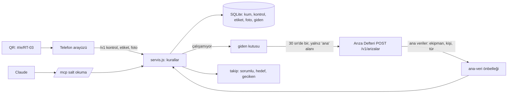
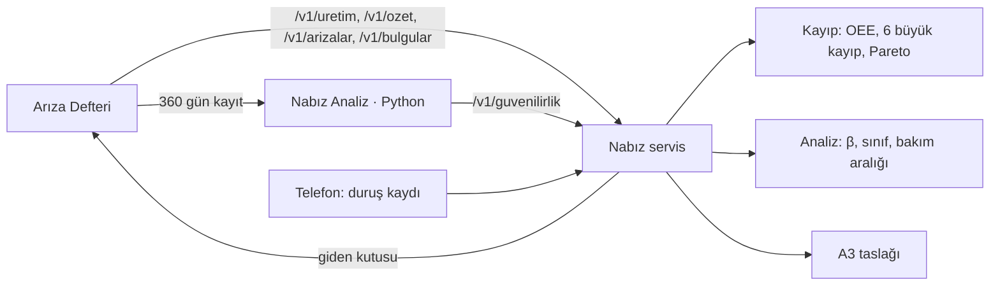

# Nabız: proje dokümanı

Kodu ben yazmamış olsam da projeyi baştan sona anlatabilmem ve savunabilmem için tutulur. Ortak altyapı (GitHub, Cloudflare, VPS, Docker, Caddy, güvenlik temeli, lisans) burada tekrar anlatılmaz: [ysfdurak.com → docs/](https://github.com/ysfdurak/ysfdurak.com/tree/main/docs). Kardeş servis: [Arıza Defteri → docs/PROJE.md](https://github.com/ysfdurak/ariza-defteri/blob/main/docs/PROJE.md).

Son güncelleme: 25 Kasım 2026 (V2.1: Pusula bağlantısı çıkarıldı, takip Nabız'da; şefin sabah özeti).

---

## 1. Bir bakışta

| | |
| --- | --- |
| **Ne** | Depo ekipmanı için TPM uygulaması (telefon): QR ile vardiya başı otonom bakım kontrolü, kırmızı/beyaz etiket (sorumlu ve hedef tarihle), Arıza Defteri'ne arıza |
| **Kimin için** | Operatör (kontrol, etiket), teknisyen (kırmızı etiketi kapatır), vardiya şefi ve yönetici (özet) |
| **Canlı adres** | https://nabiz.ysfdurak.com **[doğrulanacak: henüz kurulmadı]** |
| **Depo** | https://github.com/ysfdurak/nabiz |
| **Durum** | V2 bitti: duruş kaydı, OEE ve 6 büyük kayıp, Pareto → A3 taslağı, güvenilirlik ve bakım aralığı (Python servisi [Nabız Analiz](https://github.com/ysfdurak/nabiz-analiz)). Sırada V3: planlı bakım takvimi, TPM adım panosu. |

## 2. Sorun ve verdiğim kararlar

**Sorun.** TPM'in ilk adımı otonom bakımdır: operatör kendi ekipmanının temel durumunu her vardiya başında kontrol eder ve gördüğü anormalliği etiketler. Kâğıt formlar kaybolur. Etiketin bakım ekibine ulaşıp ulaşmadığı belli olmaz. Kimin hangi vardiyada kontrol yapmadığı ancak ay sonunda anlaşılır. Depo personeli de işten uzun süre ayrılamaz.

| Karar | Neden | Bedeli |
| --- | --- | --- |
| Kontrol 1-2 dakika, 4-6 madde, iki büyük düğme | Personel işten çekilemiyor; uzun form doldurulmaz | Ayrıntılı ölçüm (basınç, seviye) yok |
| QR telefon kamerasıyla okunur, uygulama içi tarayıcı yok | Her telefonda çalışır, kamera izni ve kitaplık gerekmez | QR adresi değişirse etiketler yeniden basılır |
| Beyaz etiket operatörde kalır, kırmızı bakım ekibinin listesine düşer | TPM'in amacı operatörün küçük sorunları kendisinin gidermesi; bakım ekibine yalnız gerekeni göndermek | Yanlış renk seçilebilir; madde önerisiyle azaltıldı |
| Takip Nabız'da: her etiketin sorumlusu ve hedef tarihi (V2.1) | Arıza zaten Arıza Defteri'nde; aynı işi Pusula'ya da yazmak çift kayıttı (bkz. bölüm 3, "Neden Pusula çıkarıldı") | Pusula'daki bildirim ve pano yok; geciken listesi Nabız'da |
| "Ekipman çalışamıyor" → Arıza Defteri'ne gerçek arıza | Duruş tek kaynakta kalsın; Usta ve Emanet de görsün | İki sistemde kayıt var; etiket kimliği arıza açıklamasında |
| Gönderimler kuyrukta (giden kutusu) | Arıza Defteri düşerse etiket kaybolmasın, kullanıcı beklemesin | Gönderim en geç 30 saniye sonra gider; "anında" değil |
| Demo: ziyaretçi başına deneme alanı, gönderim benzetimi | Herkes deneyebilsin ama gerçek Arıza Defteri'ni kirletemesin | Ziyaretçi gerçek entegrasyonu göremez, "gidecek içerik"i görür |
| Kurum modu: tek site şifresi + kişi seçimi | V1'i yalın tutmak | Kişiye özel giriş yok: herkes herkes adına kayıt açabilir. **Bilinen sınır.** |

## 3. Mimari ve veri akışı



**Alan (kum) kavramı.** Her satır bir alana aittir. `ana` kurumun gerçek alanıdır. Demo ziyaretçisi açtığında kendine rastgele bir alan açılır (çerezle bağlanır, 72 saatte silinir). Gönderimler yalnız `ana` alanından gerçekten gider. Ziyaretçi alanında aynı içerik "benzetim" olarak saklanır ve ekranda gösterilir.

**Bir kırmızı etiketin hayatı:**

```
Operatör kontrol → "Zeminde yağ izi" sorun var → kırmızı etiket + foto + çalışamıyor
  ├─ hedef: ertesi gün (duran ekipman), sorumlu: sonra atanacak
  └─ giden: ariza_bildir → Arıza Defteri: G-20261124-…, RT-HID, açık
Şef (Ayşe) etikete Serkan'ı sorumlu atar; hedef geçerse etiket "1 gün gecikti" olur, Özet'te görünür
Teknisyen (Serkan) "Conta değişti" ile kapatır
  └─ giden: ariza_kapat  → Arıza Defteri kaydı kapanır, süre hesaplanır, çözen Serkan
```

Yerelde servisler birlikte çalıştırılıp bu akış uçtan uca denendi (V1'de Pusula dahil; V2.1'de Pusula çıkarıldı).

### Neden Pusula çıkarıldı (V2.1, 25.11.2026)

V1'de her kırmızı etiket Pusula'da da iş açıyordu. Kurulum aşamasında şu soru soruldu: *"Arıza kaydı zaten var, açan kapatan belli. Bunu tekrar Pusula'ya almak gerçekten gerekli mi?"* Cevap hayırdı:

| | Arıza Defteri | Pusula | Nabız (V2.1) |
| --- | --- | --- | --- |
| Cevapladığı soru | Ne oldu? (ekipman, tür, süre, kim açtı, kim çözdü) | Ne yapılacak? (kime, ne zamana) | Ne yapılacak, kimde, gecikti mi? |
| Kırmızı etiket için | Gerekli: analiz ve OEE buradan beslenir | Aynı işin ikinci kopyası | Sorumlu + hedef tarih + geciken listesi |

- **Bu yapı uygun değil, şöyle uygulanır:** Aynı olay iki sistemde açılıp iki sistemde kapanıyorsa biri bozulduğunda ("Pusula'da kapalı, Nabız'da açık") hangisinin doğru olduğu tartışılır. Bu, yalın dilde *çift kayıt* israfıdır. Bir olayın tek bir kaynağı olmalı; diğer sistemler ona bakmalı.
- **Asıl ihtiyaç neydi?** Uzun süren arızanın sahibinin ve tarihinin belli olması. Bunun için kaydı başka sisteme taşımak gerekmiyordu, etikete iki alan eklemek yetti.
- **Ne kaybettik?** Pusula'nın bildirimleri ve panosu. Karşılığında kurulumda bir hizmet hesabı, bir anahtar ve bir hata noktası (MCP çağrısı) gitti.
- **Kurallar** (`src/cekirdek/kurallar.js`): Kırmızının sorumlusu teknisyen olur, beyazın operatör ya da teknisyen (şef sorumlu yapılmaz, işi dağıtır). Hedef verilmezse duran ekipman 1 gün, kırmızı 3 gün, beyaz 7 gün. Hedef günü içinde kapanan gecikmiş sayılmaz. Atamayı teknisyen ve şef yapar. Hedef geçmişe ve 90 günden ileriye girilemez (yanlış yıl yakalanır).
- **Şefin sabah özeti:** Her sabah 07:30'dan sonra (Türkiye saati) şefin telefonuna tek bildirim gider: geciken etiketler (en eskisi üstte, en çok 5), sorumlusu olmayan kırmızılar, gecikme kimde birikiyor. Bildirime dokununca "Geciken" listesi açılır. Geciken ekipman duruyorsa bildirim yüksek öncelikli gelir. Sorun yoksa bildirim gitmez (her sabah "sorun yok" gürültü olur, şef bakmamayı öğrenir). Aynı metin Özet ekranında önizleme olarak da görünür; demo ziyaretçisi bildirimi böyle görür.
  - *İçeride ne oluyor:* `src/cekirdek/sabah-ozeti.js` metni üretir (saf fonksiyon, test edilir). `server/bildirim.js` 5 dakikada bir saate bakar; saati geçtiyse ve `meta` tablosunda bugünün tarihi yoksa önce tarihi yazar, sonra gönderir. Önce yazmasının nedeni: gönderim hata verirse gün içinde tekrar tekrar denenip telefonu doldurmasın.
  - *Kanal:* ntfy.sh (Diyalog Atölyesi ile aynı). Konu adı rastgele üretilir, adresi bilen okuyabildiği için tahmin edilemez olmalı. HTTP başlıkları ASCII olmak zorunda olduğundan Türkçe başlık gövdeye yazılır.
  - **Burada bir test daha yapalım:** Kurulumdan sonra ntfy uygulamasıyla konuya abone ol; ertesi sabah bildirimin geldiğini ve dokununca listenin açıldığını gör. Hemen denemek için `.env`'de `SABAH_OZETI_SAATI`'ni birkaç dakika sonraya al ve betiği yeniden çalıştır (o gün henüz gönderilmediyse gider).
- **Beyaz etiketler için sonraki adım:** İyileştirme önerisi niteliğindeki beyazlar İvme'ye (kaizen) gidebilir. Bu Pusula'dan daha doğal bir eşleşme; karar V3'te.

### V2: kayıp, OEE, güvenilirlik, A3



- **OEE** Nabız'ın çekirdeğinde hesaplanır (`src/cekirdek/oee.js`). Arıza Defteri ham vardiya verisini verir, TPM yorumu Nabız'dadır. Toplarken oranların ortalaması alınmaz: süreler ve adetler toplanır, oran sonra hesaplanır. Sentetik depoda OEE yaklaşık %75'tir: kullanılabilirlik %97, performans %78, kalite %99,6. Kaybın asıl kaynağı hız (bekleme, yol, arama).
- **Duruş kaydı:** Arıza dışındaki kayıplar (ayar, küçük duruş, hız, kalite) da telefondan girilir. Süre verilirse kapalı kaydedilir, "devam ediyor" seçilirse sonra karttan bitirilir. Arıza Defteri'ne giden kutusuyla gider ve Usta, Emanet, Analiz aynı veriyi görür. Uçtan uca denendi: Arıza Defteri'nde gerçek ve kapalı kayıt oluştu.
- **A3 taslağı** (`src/cekirdek/a3.js`): Pareto'daki bir türe dokununca açılır. 7 bölüm: konu, arka plan, mevcut durum, analiz, hedef, karşı önlemler, takip. Karşı önlemler kural tabanlıdır: aşınma ise bakım aralığı önerisi, rastgele ise kontrol listesi ve 5 Neden, erken dönem ise bakım sonrası kontrol; tekrarlayan gün ve tek kişi bulguları da eklenir. Kök neden ve sorumlular boş bırakılır, onları ekip doldurur.
- **Güvenilirlik** Nabız Analiz'den gelir (10 dakika önbellek). Servis yoksa "Analiz" ekranı 503 verir, A3 yine açılır ve o bölümde "alınamadı" yazar.

## 4. Teknoloji seçimleri

| Seçim | Neden | Elenen |
| --- | --- | --- |
| Node 22, `node:http`, `node:sqlite`, düz HTML/JS | Arıza Defteri ve Pusula ile aynı kalıp; derleme yok | React/Vite (Pusula'da var; burada gerek yok) |
| Takibi Nabız'ın içinde tutmak (V2.1) | Tek kayıt; kurulum sade | Pusula'ya MCP ile iş açmak (V1'de vardı, çift kayıt olduğu için çıkarıldı) |
| Giden kutusu tablosu | Kalıcı, yeniden denenebilir, etiket sayfasında görünür | Bellekte kuyruk (sunucu yeniden başlarsa kaybolur), anında çağrı (kullanıcı bekler) |
| `qrcode` paketi (sunucuda SVG) | Küçük, bağımlılığı az; tarayıcıya kitaplık gitmez | Dış QR servisi (ziyaretçi verisi dışarı çıkar) |
| Fotoğraf telefonda küçültülür, sunucu yalnız JPEG kabul eder | Yükleme hızlı; sunucuda resim işleme kitaplığı yok; SVG/HTML yüklenemez | Sunucuda yeniden kodlama (sharp: yerel kitaplık, büyük imaj) |
| Kişi seçimi tarayıcıda saklanır, sunucu rolü denetler | V1 sadeliği | Kişiye özel giriş (V3) |

## 5. Kod turu

| Dosya | Ne yapar | Dikkat |
| --- | --- | --- |
| `src/cekirdek/kontrol-listeleri.js` | Tip başına maddeler; her maddenin önerilen rengi ve Arıza Defteri türü | Test, her türün Arıza Defteri'nde olduğunu denetler |
| `src/cekirdek/kurallar.js` | `vardiyaBul`, `yetkiliMi`, `kontrolUyumu`, `sorumluOlabilirMi`, `varsayilanHedef`, `geciktiMi` | Uyumda henüz başlamamış vardiya beklenmez; hedef günü içinde kapanan gecikmiş sayılmaz |
| `src/cekirdek/ornek.js` | Demo için 7 günlük tohumlu geçmiş (gece vardiyası daha az uyumlu, RT-03 cuma hidrolik, sorter kırmızıları Murat Kaya'da) | Atama ayrı üreteçte: eklenince eski örnek veri değişmedi |
| `server/store.js` | Alanlar, kontroller, etiketler, fotoğraf, giden kutusu, sayaçlar, oturumlar | Alan silinince içindekiler `ON DELETE CASCADE` ile gider |
| `server/servis.js` | Bütün kurallar: doğrulama, yetki, sınır, kuyruğa yazma, atama, özet (geciken, sorumlu başına yük) | `kuyruk()`: alan `ana` değilse ya da bağlantı yoksa benzetim |
| `src/cekirdek/sabah-ozeti.js` | Şefin sabah özeti metni: geciken, sorumlusuz kırmızı, gecikme kimde; ne zaman gönderilmez | Saf fonksiyon; Özet ekranı aynı metni önizler |
| `server/bildirim.js` | Sabah özeti zamanlayıcısı: saat, günde bir kez, ntfy'ye POST | Önce "bugün gönderildi" işaretlenir, sonra gönderilir |
| `server/entegrasyon.js` | Arıza Defteri ve Nabız Analiz istemcileri, giden kutusu işleyicisi | Kalıcı hata (4xx) yeniden denenmez; geçici hata 6 kez denenir |
| `server/ana-veri.js` | Ekipman/kişi listesi: Arıza Defteri → son okunan → gömülü kopya | Arıza Defteri kapalıyken de açılır |
| `server/app.js` | Alan çözümleme (oturum → `ana`, çerez → deneme alanı), giriş, yollar, başlıklar, fotoğraf, QR | Kural içermez |
| `server/mcp.js` | 5 salt okuma aracı (`ana` alanı) | Yazma yok: kayıt sahadaki kişinin işi |
| `src/cekirdek/oee.js` | OEE bileşenleri, kayıp şelalesi (dakika), ekipman, tip ve gün kırılımı | Oran ortalaması değil, toplam üzerinden |
| `src/cekirdek/a3.js` | A3 taslağı: veriden 7 bölüm, kural tabanlı karşı önlemler | Kök neden ve sorumlu ekipte |
| `web/app.js` | Hash yönlendirme; ekipman, kart, kontrol, etiket, duruş, kayıp (OEE çizgisi SVG), analiz (β çubuğu SVG), A3, etiketler, özet, QR, giriş | Her metin `textContent`; SVG de DOM API ile |

## 6. Sunucu ve yayın

Ayrıntı: [docs/SUNUCU_KURULUMU.md](SUNUCU_KURULUMU.md).

- `bash ~/ysfdurak.com/sunucu/kurulum-nabiz.sh`: soru sormaz. Arıza Defteri yazma anahtarını oradaki `.env`'den alır, site şifresini, MCP anahtarını ve sabah özeti için rastgele bir ntfy konusunu üretir; sonunda abone olunacak konuyu yazar.
- Konteyner dışarıya yalnız ntfy.sh'a çıkar (sabah özeti); diğer bağlantılar iç ağda.
- İç ağ: `http://ariza-defteri:8080`, `http://nabiz-analiz:8000`. Anahtarlar internete çıkmaz.
- Konteyner salt okunur, `cap_drop: ALL`, 320 MB.

## 7. Testler

`npm test`: 27 test. Tarayıcı duman testi telefon boyutunda, açık ve koyu temada çalışır.

| Dosya | Neyi kanıtlıyor |
| --- | --- |
| `kurallar.test.js` | Vardiya sınırları; kırmızıyı yalnız teknisyen ve şef kapatır; uyum hesabı; her madde Arıza Defteri türüne bağlı; varsayılan hedef (ay geçişi dahil), gecikme, kim sorumlu olabilir |
| `entegrasyon.test.js` | Gönderim sırası ve arıza kimliğinin etikete yazılması; geçici hata yeniden denenir, kalıcı hata hemen "hata"; ziyaretçi alanı hiç gönderilmez |
| `api.test.js` | Deneme alanı açılır ve yalıtılır; çerez bayrakları; kontrol doğrulaması; kırmızı etiket akışı ve yetki (gönderim yalnız Arıza Defteri'ne); sorumlu ve hedef kuralları, atama yetkisi, geciken ve sorumlu filtreleri, özetteki sayılar; fotoğraf (JPEG baytları, 415, 413, başka site 403, sıkı CSP); IP ve alan sınırları; giriş sınırı (5 deneme); kurum modu; QR; MCP |
| `v2.test.js` | OEE elle hesaplananla aynı ve toplamda süre ağırlıklı; gerçek veride A × P × K = OEE; A3'te aşınma ve cuma bulgusu karşı önlem olarak geliyor; kayıp, güvenilirlik ve A3 uçları; analiz servisi yokken 503 ama A3 açık; duruş kaydı (süreli ve devam eden) ve hatalı girdiler; duruşun arıza kimliği giden kutusunda duruşa yazılıyor |
| `sabah-ozeti.test.js` | Sorun yoksa gönderilmez; en eski gecikme üstte, en çok 5 satır, kişi özeti; duran ekipman gecikmişse yüksek öncelik; saatten önce gitmez, günde bir kez gider, başlıklar ASCII, ağ hatası fırlatılmaz; ayar doğrulaması |
| `gercek-ip.test.js` | Sahte başlıkla hız sınırı atlatılamaz |
| `tarayici/duman_test.py` | Kişi seç → kart → kontrol (1 sorun) → kırmızı etiket + foto (1280 piksele küçüldü mü) → sayfada Pusula yok → operatör kapatamaz → teknisyen sorumlu atar ve kapatır → geciken etiketler → özet (sabah özeti önizlemesi, sorumlu başına iş) → QR; konsol hatası yok |

Örneklem (24 Kasım 2026, yerel, üç servis birlikte):

| Adım | Beklenen | Gözlenen | Durum |
| --- | --- | --- | --- |
| Kurum girişi + kırmızı etiket (çalışamıyor) | Arıza Defteri kaydı açılır | 30 sn içinde "gönderildi", kimlik etikette | Geçti |
| Operatör kırmızıyı kapatmaya çalışır | 403 | 403 | Geçti |
| Teknisyen kapatır | Arıza kapalı, çözen Serkan Aydın | Öyle | Geçti |
| (25.11) Teknisyen sorumlu atar, geciken filtresi | Sorumlu kartta, vitrinde geciken etiket "N gün gecikti" | Öyle (ekran: `etiket-ata.png`, `etiketler-geciken.png`) | Geçti |
| Güvenlik taraması | Temiz | Temiz | Geçti |
| Gerçek telefonda QR okutma | Kart açılır | 26.11.2026 Android: kart açıldı | Geçti (Android) |
| Vardiya kontrolü ve kırmızı etiket (fotoğrafsız), deneme alanı | Kayıt açılır | 26.11.2026 Android: kontrol girildi, kırmızı etiket açıldı | Geçti (Android) |
| Etikete fotoğraf ekleme | Fotoğraf etiket detayında görünür | 26.11.2026 Android: fotoğraf yüklendi, detayda göründü | Geçti (Android) |
| iPhone (Safari): QR, kontrol, fotoğraf | Aynı | **Denenmedi: iPhone yok.** Risk en çok fotoğrafta (kamera izni, HEIC biçimi) | Açık |

**Burada bir test daha yapalım:** QR'ı gerçek telefon kamerasıyla okut. Fotoğraf çekmeyi Android ve iPhone'da dene (`capture=environment` davranışı tarayıcıya göre değişir). Kurum alanında bir kırmızı etiketin Arıza Defteri'nde gerçekten açıldığını gör.

## 7b. Kullanıcı gözüyle (26.11.2026)

V2 ve V2.1'de 6 ekran eklendi (Kayıp, Analiz, A3, sorumlu atama, Geciken, sabah özeti). Teknik testler temizdi (taşma yok, konsol hatası yok). Ekranlar bu kez operatör, teknisyen, şef, ilk kez gelen ziyaretçi, mülakatçı ve bakım uzmanı gözüyle, 390 ve 1350 piksel genişlikte gezildi.

**Teşhis:** Uzun sayfalar sonucu söylemiyordu, bazı bilgiler iki kez gösteriliyordu ve iki kural sahada böyle yürümez.

| Bulgu | Rol | Karar |
| --- | --- | --- |
| Kontrolde "Hepsini tamam işaretle" düğmesi | Bakım uzmanı | **Kaldırıldı.** Otonom bakımın özü bakarak kontrol; toplu işaretleme "kâğıt doldurma"yı kolaylaştırır. Yerine Özet'te **Hızlı kontrol** göstergesi: madde başına 6 sn'den kısa süren kontroller ve kimde oldukları (ceza değil, konuşma konusu). |
| Acil stop arızasına 3 gün hedef | Bakım uzmanı | **Emniyet maddeleri** (fren, çatal, acil stop, bariyer): sorun varsa etiket kırmızı, ekipman duruyor sayılır, hedef aynı gün; formda beyaz seçilemez. Sunucu da aynı kuralı uygular. |
| Etiketlerde 9 düğme, etiketsiz 3 grup; "Hepsi" ile "Herkes" yan yana | İlk kez gelen | İki adlı satır: **Göster** (Açık · Geciken · Bana atanan · Kapalı) ve **Renk**. |
| Analiz telefonda 5.835 px, 972 kelime; aynı cümle 20 kartta | Şef, mülakatçı | Üstte tek paragraf sonuç ("forklift, reach truck… için bakım sıklaştırılmalı; streç uzatılabilir"). Kartta yalnız aşınma ve erken dönem türleri; rastgele türler adıyla kısa listede. β açıklaması bir kez, açılır bölümde. **3.378 px, 533 kelime.** |
| Kayıp sayfası sayılarla açılıyor, "bu ne diyor?" yok | Yönetici | Tek cümle: "planlı sürenin %75'i değerli işe gitti, en büyük kayıp hız (%21): ekipman çalışıyor ama ideal hızın altında." OEE formülü açılır bölüme. |
| Özet'te geciken etiketler iki kez (sabah özeti önizlemesi + liste) | Şef | Liste kaldı, önizleme açılır bölümde. |
| Demo şeridi 3 satır, ilk gelen nereden başlayacağını bilmiyor | Mülakatçı | Şerit 1 satır; Ekipman sayfasında demoya özel **5 dakikada dene** (kontrol → geciken → Kayıp/Analiz). |
| Bakım aralığında "Ekipman başına yılda 229 arıza" | Şef | Kafa karıştırıyordu; yerine duruş maliyeti ve yüzde düşüş. |

**Ders:** Bu bulguların hiçbirini teknik test yakalamadı. "Hepsini tamam" düğmesi çalışıyordu, acil stop etiketi açılıyordu. Sorunu görev odaklı ve sahayı bilen bakış buldu: "operatör bunu nasıl kullanır, bakım şefi buna ne der?"

**Karar bekleyen (gerçekçilik):** Arıza Defteri'nin sentetik verisinde forklift başına yılda yaklaşık 230 arıza var (ortalama arızalar arası süre 31 saat). Bunun 96'sı "akü şarjı bitti". Sahada bir forkliftin bakım ekibi gerektiren arızası ayda birkaç tanedir; akü bitmesi ise arıza değil, operasyon olayıdır (küçük duruş). Seçenekler: yoğunluğu düşürmek ve operatör kaynaklı olayları "küçük duruş" diye ayırmak (analiz için veri azalır, kör deneme yeniden yapılır) ya da olduğu gibi bırakıp dokümanda belirtmek.

## 8. Bilinen sınırlar ve sonraki adımlar

- **iPhone'da denenmedi (26.11.2026).** Android'de QR, kontrol, etiket ve fotoğraf geçti. iPhone'da birine `#/e/FL-01` QR'ını okutup fotoğraflı bir kırmızı etiket açtırmak 2 dakika sürer; yapılana kadar "iOS desteklenir" denmemeli.

- **Kişiye özel giriş yok.** Kurum modunda şifreyi bilen herkes herkes adına kayıt açabilir. Bir pilot için yeterli, gerçek kullanım için değil. *Şöyle daha iyi olur:* V3'te Pusula'daki gibi Google/Microsoft girişi ya da kişiye özel PIN.
- **Demo vitrini her gece silinir.** Kurum alanında yapılan gerçek denemeler de gider. Arıza Defteri'ne gönderilmiş ama kapatılmamış arıza orada açık kalır.
- **Sabah özeti tek kişiye, tek kanala.** Bildirim bir ntfy konusuna gider; konuyu bilen herkes okur. Teknisyene "sana atanan geciken" bildirimi yok. *Şöyle daha iyi olur:* kişiye özel giriş gelince (V3) kişi başına bildirim.
- Çevrimdışı çalışma yok: depoda kapsama zayıfsa kontrol gönderilemez.
- OEE'nin performans kısmı sentetik (ideal hızın %68–88'i). Gerçek depoda WMS hareket kayıtlarından gelmeli.
- A3 taslağı dışa yalnız metin ve yazdırma ile çıkıyor. Yalın Araçlar yazılınca oraya aktarılacak.
- Sırada V3: planlı bakım takvimi (Analiz'in önerdiği aralıklarla), TPM 7 adım panosu, kişiye özel giriş.

## 9. Mülakat soruları

1. **Neden kontrol listesi bu kadar kısa?** Personel işten çekilemiyor. 2 dakikayı geçen form doldurulmaz ya da ezbere "tamam" basılır. Az ama gözle görülebilen maddeler seçtim.
2. **Beyaz ve kırmızı etiket farkı ne, neden önemli?** Beyazı operatör kendisi giderir; TPM'in amacı operatörü ekipmanının sahibi yapmak. Kırmızı bakım ekibine gider. Böylece bakım ekibinin kuyruğu yalnız gerçek işlerden oluşur.
3. **İlk sürümde kırmızı etiket Pusula'ya da gidiyordu, neden çıkardın?** Aynı arıza iki sistemde açılıp iki sistemde kapanıyordu; çift kayıttı. Arızanın tek kaynağı Arıza Defteri. Asıl ihtiyaç "kimde, ne zamana?" sorusuydu, onu etikete sorumlu ve hedef tarih ekleyerek Nabız'ın içinde çözdüm. Kurulumdan bir hizmet hesabı, bir anahtar ve bir hata noktası da gitti.
4. **Arıza Defteri kapalıysa ne olur?** Etiket yine açılır. Gönderim kuyrukta bekler, 1-5-15-60 dakika arayla denenir, sonunda "gönderilemedi" olarak etiket sayfasında görünür. 4xx gibi kalıcı hata yeniden denenmez.
5. **Demo ziyaretçisi gerçek Arıza Defteri'ni nasıl kirletmiyor?** Her ziyaretçinin kendi alanı var. Gönderimler yalnız `ana` alanından gider. Ziyaretçi gidecek içeriği görür ama gönderim yapılmaz. Test bunu denetliyor.
6. **Fotoğraf yüklemesi nasıl güvenli?** Telefonda küçültülüp JPEG'e çevriliyor. Sunucu başlık ve son baytlara bakıyor, 1,5 MB sınırını okurken sayıyor, yalnız `image/jpeg` kabul ediyor. Okurken `default-src 'none'` CSP veriyor. Deneme alanları için günlük toplam fotoğraf sınırı da var (disk).
7. **Kontrol uyumu nasıl hesaplanıyor?** Ekipmanın çalıştığı ve başlamış her vardiya bir beklentidir. Aynı vardiyada iki kontrol bir sayılır. Sorter gece çalışmadığı için gece beklenmez.
8. **Ekipman listesi nereden geliyor?** Arıza Defteri'nden. Ulaşılamazsa son okunan liste, o da yoksa depodaki kopya kullanılır. Nabız hiçbir durumda listesiz kalmaz.
9. **En büyük eksik?** Kişiye özel giriş. Bilinçli olarak V1'in dışında bıraktım ve belgeledim.
10. **Bir şeyi yeniden yapsan?** Entegrasyonu baştan "hangi sistem hangi sorunun tek kaynağı?" sorusuyla tasarlardım. Pusula bağlantısını kurup sonra çıkarmam bu soruyu geç sormamdandı.
11. **OEE'yi nasıl topladın?** Oranların ortalamasını almadım. Planlı süre, duruş, ideal süre ve iyi iş toplanıp oran sonra hesaplandı, böylece uzun vardiya kısa vardiyadan ağır basar. Test, iki vardiyalı örnekte basit ortalamanın farklı çıktığını gösteriyor.
12. **Depo OEE'si %75, iyi mi?** Dünya sınıfı %85 kabul edilir ama bu üretim hatları için. Depoda asıl kayıp hızdır (bekleme, yol, arama). Kullanılabilirlik %97 iyi, yani önce akış ve iş dağıtımı iyileştirilmeli, bakım değil.
13. **A3 neden kural tabanlı?** Her öneri veriden ve kuraldan çıkıyor ve nedeni gösterilebiliyor. Yapay zekâ önerisi denetlenemezdi. Kök nedeni ekip bulur, araç ekibi doğru yere yönlendirir.
14. **Etiketin hedef tarihi neden kuralla geliyor?** Operatörden her seferinde tarih istemek formu uzatır ve çoğu boş geçer. Kural (duran ekipman 1, kırmızı 3, beyaz 7 gün) makul bir varsayılan verir; şef gerekirse değiştirir. Hedef günü içinde kapanan gecikmiş sayılmaz.
15. **Sabah özeti neden sorun yokken gitmiyor?** Her sabah "sorun yok" gelen bildirim kısa sürede okunmaz olur; asıl sorun olduğunda da bakılmaz. Bildirim yalnız müdahale gerektiğinde gider. Durumu merak eden Özet ekranındaki önizlemeye bakar.

## 10. Kendini test et

- Ziyaretçi "çalışamıyor" işaretli kırmızı etiket açtı: Arıza Defteri'nde kayıt açılır mı?
- Operatör kendi açtığı kırmızı etiketi kapatabilir mi?
- Arıza Defteri 2 saat kapalı kaldı: o arada açılan "çalışamıyor" etiketlerine ne olur?
- Hedefi 24.11 olan etiket 24.11 akşamı hâlâ açık: gecikmiş mi?
- Şef Ayşe Koç bir kırmızı etiketin sorumlusu olabilir mi?
- Sorter için gece vardiyasında kontrol yapılmadı: uyum düşer mi?
- Bir ziyaretçi 1 MB'lık SVG dosyasını `image/jpeg` diye gönderirse?

Cevaplar (önce kendin dene): Hayır, benzetim olarak saklanır · Hayır, 403; beyazı kapatabilir · Kuyrukta bekler, Arıza Defteri açılınca gönderilir (6 denemeye kadar, son aralık 60 dk) · Hayır, 25.11'de gecikmiş olur · Hayır, kırmızının sorumlusu teknisyen olur; şef atar · Hayır, sorter gece çalışmaz, beklenmez · 415: ilk baytlar JPEG değil.

## 11. Elle yapılacak alıştırma

**Değişiklik (15 dakika):** Streç makinesi listesine yeni bir madde ekle: `{ kod: 'kesici', metin: 'Film kesici bıçağı keskin, koruması yerinde', renk: 'kirmizi', tur: 'ST-AYR' }`. Ardından:

1. `npm test`: `kurallar.test.js` yeni maddenin türünü denetler.
2. `npm run start:dev`, ST-01 kartından kontrolü başlat: 5 madde görmelisin.
3. Yanlış bir tür yaz (`ST-XXX`) ve testin yakaladığını gör.

**5 dakikalık demo:**
1. QR sayfasını göster, telefonla birini okut: kart açılır.
2. Kontrolü başlat, "hepsini tamam" de, bir maddeyi "sorun var" yap, kaydet: süreyi göster.
3. Kırmızı etiket aç, fotoğraf ekle, "çalışamıyor" işaretle. Etiket sayfasında Arıza Defteri gönderimini göster (demoda "gidecek içerik").
4. Kişiyi operatörden teknisyene değiştir, kendini sorumlu ata, etiketi kapat: kapatma gönderimi eklenir.
5. Özet: bugünkü uyum, geciken etiketler, sorumlu başına iş (sorter işleri Murat Kaya'da), en sık sorunlu maddeler (RT-03 hidrolik).
   "Neden Pusula'ya gitmiyor?" sorusu gelirse bölüm 3'teki karar.
6. Claude'a MCP ile "bu vardiya hangi ekipmanın kontrolü eksik?" diye sor.

## 12. Değişiklik günlüğü

| Tarih | Değişiklik |
| --- | --- |
| 25.11.2026 | Ortak ölçüm ve geri bildirim (olcum.ysfdurak.com), yalnız nabiz.ysfdurak.com'da. Ekran = adresin ilk parçası (`#/e/F-03` → `e`), işlem = POST yolunun sabit parçaları (`/v1/etiket/12/kapat` → `islem:etiket_kapat`); kimlik, ekipman kodu, not ve fotoğraf gitmez. Kurum kurulumunda betik yüklenmez. Ders: ölçüme ham adres verilseydi her ekipman ayrı bir "ekran" sayılırdı; yönetim sayfası okunmaz hâle gelirdi. |
| 26.11.2026 | Kullanıcı gözüyle inceleme (bölüm 7b): "Hepsini tamam" kaldırıldı, hızlı kontrol göstergesi; emniyet maddeleri (kırmızı, ekipman duruyor, hedef aynı gün); Etiket filtreleri iki adlı satır; Analiz ve Kayıp tek cümlelik sonuçla açılıyor, Analiz %42 kısaldı; sabah özeti önizlemesi açılır bölümde; demoda "5 dakikada dene". 27 test. |
| 25.11.2026 | V2.1: Pusula bağlantısı çıkarıldı (çift kayıt). Etikete sorumlu ve hedef tarih: varsayılan hedef kuralı, atama (teknisyen/şef), geciken ve "bana atanan" filtreleri, Özet'te geciken, sorumlusuz kırmızı ve sorumlu başına iş, ekipman listesinde gecikme rozeti; MCP'de `sorumlu` ve `geciken` filtreleri. Örnek veride atama. Kurulum artık soru sormuyor. CI duman testi üç servisle. Aynı gün: şefin sabah özeti (ntfy, 07:30, sorun yoksa gitmez, Özet'te önizleme; kurulum konu üretir). 26 test. |
| 24.11.2026 | V2: duruş kaydı (süreli ya da devam eden, giden kutusuyla Arıza Defteri'ne), OEE çekirdeği ve Kayıp ekranı (KPI, kayıp şelalesi, günlük OEE çizgisi, 6 büyük kayıp, Pareto, ekipman OEE), Analiz ekranı (Nabız Analiz'den β ve bakım aralığı), Pareto → A3 taslağı (yazdır, metni kopyala), 3 yeni MCP aracı, 6 test + tarayıcı testine V2 adımları, sayfaya meta CSP. Sekmeler: Ekipman · Etiket · Kayıp · Analiz · Özet (QR, Özet'e taşındı). |
| 24.11.2026 | V1: tip başına kontrol listeleri, QR (SVG), vardiya kontrolü, kırmızı/beyaz etiket ve fotoğraf, rol kuralları, giden kutusu (Pusula MCP, Arıza Defteri API), demo alanları ve sınırları, kurum girişi, özet, 5 araçlı salt okuma MCP, 16 test + tarayıcı testi, Docker sertleştirmesi, kurulum betiği ve Caddy bloğu, güvenlik taraması temiz. Uçtan uca yerel deneme: Pusula işi ve Arıza Defteri kaydı açıldı ve kapandı. |
